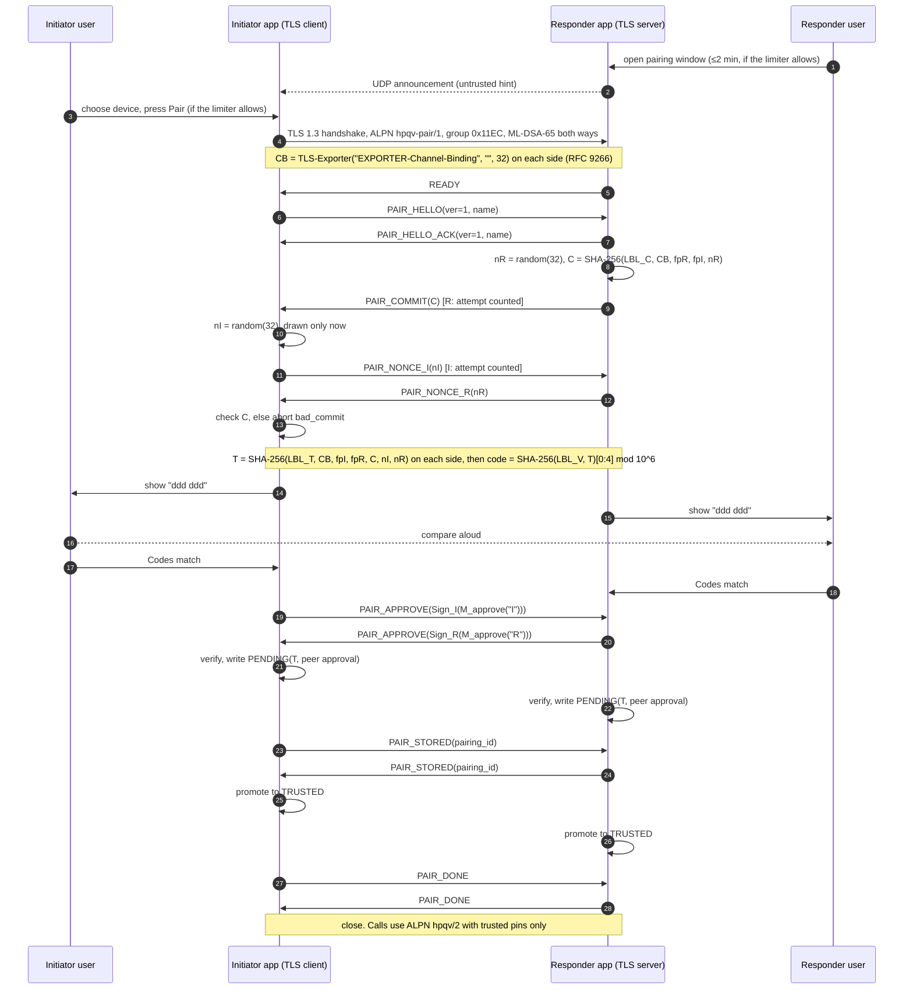

# Phase B2: No-files device pairing — revision 2 (detailed, SUPERSEDED by the concise revision 3 in 2026-10-16-b2-pairing-design.md; kept for reference)

Date: 2026-10-16. Branch `feat/secure-session-v2`, B1 committed at `932fb1f`
(unchanged by this design).

**Status: design proposal only.** It has not been formally verified, externally
reviewed or implemented, and it is not production-secure. The comparison-code
construction in §4 is **our own**: it borrows the commit-then-reveal pattern of
Bluetooth Numeric Comparison and ZRTP, but neither of those protocols, nor any
published analysis of them, validates this design.

**What changed since revision 1** (your 2026-10-16 review):
- the full commit-then-reveal messages and the active-MITM argument (§3–§4);
- rate limits across reconnects, sessions and windows (§4.6);
- a signed-approval recovery protocol for pending pairings (§6.3);
- an implementation plan that includes the Windows fixes (§11);
- every citation re-checked (§9).

Your decisions on revision 1:
- **Approved:** D2, D3, D4, D6, D8.
- **Provisionally approved:** D1 and D5, pending a security review of the exact
  six-digit construction (§4).
- **Approved with conditions:** D7, under the recovery constraints in §6.3.

Labels used throughout:
- **[STD]**: a published standard. The text was checked on 2026-10-16 (§9).
- **[LIB]**: existing library behaviour, verified on this machine unless noted.
- **[OURS]**: our own construction or design choice; needs review.
- **[UNVERIFIED]**: not confirmed. A short reason is given each time.

---

## 1. Executive summary and recommended design

Two people on the same Wi-Fi pair two devices without exchanging files:

1. **Discovery [OURS, D2].** A standard-library UDP broadcast lists nearby devices.
   It only gives hints: nothing in it is trusted.
2. **Fresh TLS 1.3 session [STD/LIB].** It uses the B1 profile: X25519MLKEM768,
   mutual ML-DSA-65 authentication, TLS 1.3 only, no resumption. It runs under a
   **separate ALPN, `hpqv-pair/1` [OURS, D3]**, which accepts a peer key that is
   not yet pinned. A pairing session never carries a call.
3. **Commit-then-reveal inside TLS [OURS].** The responder commits to a
   256-bit nonce. The initiator then sends its nonce, and the responder reveals.
   Both sides derive:
   - a transcript hash `T` that binds the RFC 9266 TLS channel binding [STD],
     both identity fingerprints, the commitment and both nonces;
   - from `T`, a **6-digit code** [OURS, D5].
4. **Both users compare the code and press "Codes match" [D4].** Each device then
   sends an **ML-DSA-65 signature over `T` (an "approval") [OURS].** A "Don't match" invalidates
   the attempt and everything ephemeral in it.
5. **Two-phase commit.** Each side stores the peer as *pending*, together with the
   peer's verified approval. It promotes the peer to *trusted* only on receiving
   the peer's `PAIR_STORED` for the same `T`.
   - An interrupted commit can finish within 24 h **only** through a recovery
     exchange.
   - That exchange needs signatures from **both** users' devices over the **same
     `T`**; reconnecting is never enough (§6.3).
6. **Calls stay on the unchanged B1 path:** ALPN `hpqv/2`, pinned *trusted* keys
   only. The voice protocol does not change.

---

## 2. Threat model and security goals

### 2.1 Adversary
The adversary is on the same Wi-Fi and can:
- observe, intercept, modify, delay, duplicate, replay and drop any traffic;
- run fake listeners and pose as the pairing service;
- open many pairing sessions, abort them at any point, and switch IP addresses
  and identity keys at will;
- send malformed traffic and force disconnects.

It controls neither endpoint and holds neither identity private key, unless
stated otherwise in §2.3.

### 2.2 Goals

| # | Goal | Mechanism |
|---|---|---|
| G1 | An active MITM ends up in both stores with probability ≤ N·(1.00002×10⁻⁶) + ε, where N is the number of pairing attempts allowed (§4.6) and ε covers SHA-256/ML-DSA breaks | §4.5 argument [OURS] |
| G2 | Neither device trusts a peer unless **both** users approved the **same** transaction `T` | Signed approvals, two-phase commit (§3, §6) [OURS] |
| G3 | Pairing is never weaker than the B1 TLS profile | B1 `_context` restrictions [LIB] |
| G4 | No message from another or older session is accepted | TLS 1.3 records [STD]; everything is bound to `CB` [OURS] |
| G5 | Unrelated traffic cannot permanently block the listener, and its resource use stays bounded | §7.4 [OURS] |
| G6 | Failures fail closed; a *pending* record never authorises a call | §6 [OURS] |
| G7 | No silent key replacement | §5 [OURS] |

### 2.3 What is and is not protected
- **Active MITM.** It is detected when the users really compare the code (§4.5).
  It is **not** detected if they confirm without comparing.
- **Denial of service.** It can't be prevented; the damage is bounded (§4.6, §7.4).
- **Compromised endpoint.** Out of scope: malware can sign approvals and show any
  code.
- **Stolen identity key.** The thief can pose as that device to existing friends,
  and can sign approvals as it. Recovery is manual: friends remove the device, and
  its owner re-pairs with a new key (§5.6).
- **User confirms a wrong code.** If both users confirm codes that differ, the MITM
  wins that attempt. This is a human limit; §4.8 covers the UX mitigations.
- **Fake listener.** It can complete TLS with its own key, but the codes won't
  match.
- **Replay.** Values from another session can't be used: TLS 1.3 record
  protection [STD], plus binding to `CB`.
- **Malformed input.** Fixed-size fields, bounded frames, abort on anything
  unexpected.

### 2.4 Assumptions
- **A1. Both users actively approve.** The responder opens a pairing window, the
  initiator presses Pair, and both press "Codes match". **Required.**
- **A2. Comparison channel.** The users compare the code over a channel the
  attacker can't alter: the same room, or a voice call they already trust.
- **A3. Library correctness.** OpenSSL 4.0.2 (bundled in `cryptography` 50.0.1)
  and pyOpenSSL 26.4.0 implement TLS 1.3, X25519MLKEM768, ML-DSA-65, SHA-256 and
  RFC 9266 exporters correctly [LIB; the B1 interop and KATs are evidence, not
  proof].
- **A4. Randomness.** `secrets.token_bytes` is a good CSPRNG.
- **A5. No same-user local attacker.** One would also be able to read the private
  key.

---

## 3. Message sequence

### 3.1 Discovery: untrusted, D2 approved
- **Format:** a UDP broadcast every 2 s of a JSON object of at most 512 B:
  `{"app":"hpqv","v":2,"name":…,"port":…,"fp":<16 hex>,"pairing":<bool>}`.
- **Bounds:** entries expire after 6 s; at most 64 entries are kept; the device's
  own fingerprint is ignored.
- **What it cannot do:** no key material is carried, and an announcement never
  causes trust, a prompt or a connection.

### 3.2 Framing
- **Frames:** pairing reuses `SecureChannel.send/recv` framing
  (`type u8 ‖ len u16 BE ‖ payload`) inside TLS application data [LIB, existing].
- **Size limit [OURS]:** ML-DSA-65 signatures are 3,309 B, larger than today's
  `secure.MAX_CONTROL_PAYLOAD = 1024`. The limit therefore becomes per-channel:
  - **1024** on `hpqv/2` (unchanged);
  - **4096** on `hpqv-pair/1`.

  The limit is checked before any allocation, as today.
- **Ordering:** every pairing message has a fixed position in §3.3. Any other
  type, length or order aborts the session (`PAIR_ABORT(protocol)`).

### 3.3 Exact messages [OURS, except T and P0]

**Roles:** I is the initiator (TLS client); R is the responder (TLS server).
**Encoding:** all lengths are exact; multi-byte integers are big-endian.

| # | Dir | Type | Payload (exact) | Sent when | Receiver validation |
|---|---|---|---|---|---|
| T | I↔R | TLS 1.3, ALPN `hpqv-pair/1` | B1 profile | I's user pressed Pair, and the limiter allows it (§4.6) | B1 checks: group 0x11EC, sigalg 0x0905, TLS 1.3. Peer cert is ML-DSA-65 and its key ≠ own key. **R** proceeds only if the pairing window is open, no other pairing or resume session is active, and the limiter allows it. Otherwise R closes **before** P0, and the attempt is not counted |
| P0 | R→I | `0x04 READY` | empty | R accepted the session | I waits ≤ 10 s |
| P1 | I→R | `0x10 PAIR_HELLO` | `ver u8 = 1` ‖ `name_len u8 (1..64)` ‖ `name` (UTF-8) | after P0 | `ver == 1`; valid UTF-8; NFC; no control characters; ≤ 32 code points |
| P2 | R→I | `0x11 PAIR_HELLO_ACK` | same layout | after P1 | same |
| P3 | R→I | `0x12 PAIR_COMMIT` | `C` (32 B) | after P2. R draws `nR` here and holds it in memory only | `len == 32`. **Counts one attempt on R** |
| P4 | I→R | `0x13 PAIR_NONCE_I` | `nI` (32 B) | after P3. **I draws `nI` only after receiving P3** | `len == 32`. **Counts one attempt on I** |
| P5 | R→I | `0x14 PAIR_NONCE_R` | `nR` (32 B) | after P4 | I recomputes `C′` (§4.2); `hmac.compare_digest(C, C′)`. Failure: `PAIR_ABORT(bad_commit)`, a mismatch-class failure (§4.6) |
| — | both | display code | — | I after a valid P5; R after sending P5 | — |
| P6a | both, any order | `0x15 PAIR_APPROVE` | `sig` (3,309 B) = ML-DSA-65 `Sign(sk_self, M_approve(role_self), ctx=b"hpqv-pair/1")` (§4.3) | only after this side's user pressed "Codes match" (buttons enabled 2 s after display) | verify `sig` with the **peer certificate of this TLS session**, over `M_approve(role_peer)` computed **locally** from our own `T`. Failure: abort |
| P6b | both | `0x16 PAIR_REJECT` | `reason u8`: 1 = codes differ, 2 = cancelled, 3 = timeout | the user pressed "Don't match", cancelled, or the 60 s decision timer expired | receiver aborts; mismatch-class if reason = 1 |
| P7 | both | `0x17 PAIR_STORED` | `pairing_id` (16 B) | after this side has (a) its own user's approval, (b) the peer's verified P6a, and (c) written the **pending** record durably (§5.4) | `pairing_id` equals the local value, else abort |
| P8 | both | `0x18 PAIR_DONE` | `pairing_id` (16 B) | after promoting to trusted (best effort) | informational |
| PX | either | `0x1F PAIR_ABORT` | `reason u8` | any protocol error | receiver aborts |
| Rx | — | `0x20` / `0x21` | resume messages, §6.3 | — | — |

**Rules on both sides:**
- Never send P6a before the local user has approved.
- Never write a pending record without a verified peer approval for our own `T`.
- Never promote a record without the peer's P7 for the same `pairing_id`.

### 3.4 Sequence diagram



---

## 4. Comparison code: exact construction and security argument

### 4.1 What is established, and what is ours

| Element | Status |
|---|---|
| TLS 1.3: each side proves it holds its identity key (CertificateVerify) | **[STD]** RFC 9846; ML-DSA-65 per draft-ietf-tls-mldsa-06 (not yet an RFC) |
| `CB`: label `"EXPORTER-Channel-Binding"`, zero-length context, 32 B | **[STD]** RFC 9266 §2 (text checked): the binding "is defined only when the TLS handshake results in unique master secrets … always true for TLS 1.3 (see Appendix D of [RFC8446])"; uniqueness is discussed in §4.1 |
| Equal exporter output on both ends of one connection | **[LIB]** verified in B1 against Go 1.27.1 and OpenSSL 4.0.2 |
| Commit-then-reveal with the **responder** committing, fresh nonces per attempt, and a 6-digit value taken mod 10⁶ from 32 bits | **Pattern from [STD]** Bluetooth Core 6.2, Vol 3, Part H, §2.3.5.6.2 and §2.2.9 (text checked) |
| Why a commitment is needed against a MITM | **Rationale from [STD]** RFC 6189 (ZRTP) §4.4.1.1 (text checked) |
| A formal analysis of Bluetooth's Numeric Comparison | Lindell, CT-RSA 2009 (§9). **It analyses Bluetooth's protocol (ECDH public keys, AES-CMAC f4/g2), not ours** |
| The instantiation: inputs, SHA-256, labels, `T`, the approval signatures, the recovery protocol, the composition with TLS | **[OURS]** No published analysis covers it. **It needs a cryptographer's review before D1/D5 are final** |

### 4.2 Definitions [OURS]

```
LBL_C  = b"hpqv-pair/1 commit\x00"      LBL_T = b"hpqv-pair/1 transcript\x00"
LBL_V  = b"hpqv-pair/1 code\x00"        LBL_ID = b"hpqv-pair/1 id\x00"
LBL_A  = b"hpqv-pair/1 approve\x00"     CTX_A = b"hpqv-pair/1"   (FIPS 204 context string)

CB   = export_keying_material(b"EXPORTER-Channel-Binding", 32, b"")      # [STD RFC 9266]
fpX  = SHA-256(raw ML-DSA-65 public key of X, 1952 B)                     # from this session's certs
nI, nR = secrets.token_bytes(32)

C    = SHA-256(LBL_C ‖ CB ‖ fpR ‖ fpI ‖ nR)                               # R → I in P3
T    = SHA-256(LBL_T ‖ CB ‖ fpI ‖ fpR ‖ C ‖ nI ‖ nR)
code = int.from_bytes(SHA-256(LBL_V ‖ T)[0:4], "big") % 1_000_000          # shown "ddd ddd"
pairing_id = SHA-256(LBL_ID ‖ T)[0:16]
M_approve(role) = LBL_A ‖ T ‖ role                                         # role = b"I" or b"R"
approval_X = ML-DSA-65.Sign(sk_X, M_approve(role_X), ctx=CTX_A)           # 3,309 B, hedged (cryptography default)
```

- **One way to read every input.** Every field has a fixed length, and the
  labels are NUL-terminated and pairwise distinct, so no input can be read two
  ways and no hash can be confused with another.
- **Local values only.** Each side computes `CB`, `fpI` and `fpR` from **its own**
  TLS session and certificates. It never takes them from a message. Display names,
  discovery data and IP addresses are **not** inputs.

### 4.3 Verification procedure (each side)
1. **Check the session.** TLS is accepted under §3.3 row T. The peer key is
   ML-DSA-65 and not our own.
2. **(I) Check the commitment.** On P5, recompute `C` from the received `nR`
   and our local `CB`, `fpR` and `fpI`; compare with `compare_digest`. A mismatch
   is `bad_commit`: abort, counted as a mismatch-class failure.
3. **Compute `T`, `code` and `pairing_id`, and display `code`.**
4. **Wait for the local decision.** The buttons stay disabled for 2 s; the
   decision must come within 60 s.
   - **Yes:** sign and send P6a.
   - **No, cancel or timeout:** send P6b and abort.
5. **Check the peer's approval.** On P6a from the peer:
   `ML-DSA-65.Verify(peer_pk, sig, M_approve(role_peer), ctx=CTX_A)`, where
   `M_approve` uses **our** `T`. A failure aborts.
6. **Store and confirm.** Write the pending record (§5.4), then send P7.
7. **Promote.** On the peer's P7 with an equal `pairing_id`, promote the record
   to trusted, send P8 and close.

### 4.4 Size and probabilities
- **Code space:** 10⁶ codes, as 6 digits.
- **Bias:** 2³² = 4,294 × 10⁶ + 967,296. The residues below 967,296 occur
  4,295 times out of 2³², and the rest 4,294 times. A target value is therefore
  hit with probability at most 4,295 / 2³² ≈ **1.00002 × 10⁻⁶**. The
  same reduction is used by Bluetooth's g2 (§2.2.9: "the six least significant
  digits of the 32-bit" value).
- **No attacker:** the codes are equal with probability 1.

### 4.5 Active-MITM argument [OURS, informal, not a proof]

**Model:**
- SHA-256 is a random oracle, so `C` is hiding (`nR` is 256-bit uniform) and
  binding (breaking it means finding a SHA-256 collision or second preimage).
- ML-DSA-65 is EUF-CMA.
- `CB` is equal at both ends of one TLS connection and differs across
  connections (A3, RFC 9266).

**Setup:** an attacker M that wants to sit between the honest devices A
(initiator) and B (responder) must run two TLS connections:
- S1 between A and M, with M acting as responder;
- S2 between M and B, with M acting as initiator.

M can't splice a single TLS connection, because it lacks the private key at one
end. If M merely relays bytes unmodified, A and B are pairing with each other,
which is the correct outcome. So `CB1 ≠ CB2`, and M presents its own key in each
session.

**What each code depends on:**
- `code_A = F(T1)`, with `T1 = SHA-256(LBL_T ‖ CB1 ‖ fpA ‖ fpM ‖ C1 ‖ nA ‖ nM1)`.
- `code_B = F(T2)`, with `T2 = SHA-256(LBL_T ‖ CB2 ‖ fpM′ ‖ fpB ‖ C2 ‖ nM2 ‖ nB)`.

**Ordering enforced by the honest state machines (§3.3):**
- **In S1:** A draws `nA` only after receiving `C1`. So `C1`, and through binding
  `nM1`, along with `CB1` and `fpM`, are all fixed **before** M learns anything
  about `nA`. Once `nA` arrives, M's only choices are to reveal the committed
  `nM1` or to abort.
- **In S2:** B fixes `nB` inside `C2` and reveals it only after receiving `nM2`.
  So `nM2`, `CB2` and `fpM′` are fixed **before** M learns anything about `nB`.

**The argument.** Take whichever of `nA` and `nB` reaches M last. When M made its
last free choice affecting the corresponding code, that nonce was still unknown
to it. In the random-oracle model, that code is then a fresh uniform value over
the reduction in §4.4, independent of everything M already knew, including the
other code. So:

    Pr[code_A = code_B] ≤ 1.00002 × 10⁻⁶ + (q² / 2²⁵⁶) + Adv_commit

where `q` is M's number of hash queries. Grinding the TLS layer (new key shares,
new randoms, new ML-DSA signatures) changes only `CB` and the fingerprints. Those
are fixed before the relevant nonce is drawn, so grinding gives M no advantage.

**This matches the argument in Bluetooth Core 6.2 §2.3.5.6.2.** That section
says: "the attacker must commit to at least the second of its nonces before
knowing the second nonce from the legitimate devices". We apply the same
reasoning to different inputs. Applying it is our claim, not Bluetooth's.

**Silent aborts.** M may abort whenever it sees, from `nA` or `nB`, that the codes
would differ, and then try again. Each try is an independent ≈10⁻⁶ chance, so
over N tries the success chance is at most about N × 10⁻⁶. This is why the
limiter in §4.6 counts **every** attempt that reached P3 or P4, whether it
finished or not.

**Approvals add no attack surface:**
- An approval binds `T`, and `T` binds `CB`, so it is worthless in any other
  session.
- Forging one requires breaking ML-DSA-65.
- Approvals carry recovery evidence (§6.3); they are not needed for the MITM
  bound.

**What the argument does not cover:**
- users who don't compare (§4.8);
- a flaw in our composition with TLS or in the OpenSSL exporter (A3);
- endpoint compromise;
- side channels;
- a formal proof. **None exists. The construction must be reviewed (D1/D5),
  and ideally modelled in Tamarin or ProVerif.**

### 4.6 Rate limits: reconnects, parallel sessions, repeated windows [OURS; backoff after Bluetooth §2.3.6]

**Definitions:**
- **Attempt:** a session in which R sent P3 (counted on R) or I sent P4
  (counted on I). Sessions that fail before P3 are handled only by the listener's
  connection limits (§7.4).
- **Failure:** any attempt that does not end with both approvals verified.
  - **Mismatch class:** "Don't match" (P6b reason 1) or `bad_commit`.
  - **Abort class:** a timeout, a cancel, a disconnect after P3/P4, or a protocol
    error.

**State:** the limiter is **device-wide**. It is not tied to IP address or key,
both of which an attacker can change at will. It is persisted in
`<app dir>/pairing_limits.json`, which is written atomically with owner-only
permissions (§5.4). It therefore survives reconnects, app restarts and new
windows. It stores the UTC timestamps of failures in the last 24 h. Timestamps
in the future (a clock rollback) are treated as "now".

**Rules:**

| Rule | Value |
|---|---|
| Concurrency | **One** pairing or resume session per device at a time, across all connections. Extra `hpqv-pair/1` sessions are closed before READY; they are not attempts, but they do count against the listener's per-IP limit |
| Per window | ≤ **3** attempts. The window **closes immediately on any mismatch-class failure**, and the user must reopen it |
| Backoff (Bluetooth Core 6.2 §2.3.6: "shall be increased exponentially … limited to a maximum … decrease … when no new failed attempts") | After `f` failures in the last 24 h, the next attempt, whether a new window or a Pair press, is refused until `30 s × 2^(f−1)` has passed since the last failure, capped at **1 h**. As failures age out of the 24 h window, `f` shrinks |
| Daily cap | ≥ **10** failures in 24 h disables new pairing for the rest of that 24 h. An explicit settings override shows a warning |
| Initiator | No automatic retries; every attempt needs a user press. It shares the same limiter state |
| Resume (§6.3) | ≤ **3** resume sessions per pending record, then the record is deleted. These don't count toward code-attempt limits, since no new code is shown, but they do count toward listener limits |

**On a mismatch-class failure:**
- send `PAIR_REJECT` / `PAIR_ABORT` and close TLS at once;
- clear the session's `nI`, `nR`, `C`, `T` and `code`. They are held in
  `bytearray`s and overwritten (best effort: Python may keep copies), and are
  **never persisted**;
- record the failure, close the window, and show "The codes didn't match.
  Someone may be trying to intercept. Wait before trying again."

Any later attempt uses a new TLS connection (a new `CB`) and new nonces. No
ephemeral value is ever reused, and a code is never shown twice.

**Resulting bound:**
- **Per window:** at most about 3 × 10⁻⁶.
- **Per day:** at most about 10 × 10⁻⁶ under the daily cap.
- **Visibility:** every failed attempt shows the users a mismatch, or a pairing
  that failed after starting.

### 4.7 Avoiding attacker-controlled inputs
- **Hashes:** only `CB` and the fingerprints (both local, from the authenticated
  session), plus nonces fixed by the commit order, go into `C`, `T`, `code` and
  `pairing_id`.
- **Names:** display names appear in the UI and the store, never in a hash.
- **Discovery** can't influence anything cryptographic.

### 4.8 Limitations and UX (D4 approved: buttons)
- **The "Codes match" button stays disabled for 2 s** after the code is shown.
  The code is shown large next to the peer's name and its short fingerprint.
- **The code proves the two devices talk to each other.** It does not prove the
  peer is the device the user *intended*; labels are the only defence.
- **Non-repudiation (privacy).** An approval signature can later show a third
  party that device X approved pairing transcript `T`. It is stored only by the
  peer.

---

## 5. Identity and persistence model

### 5.1 Identity and location (D8 approved)
- **Identity:** `identity.new` makes an ML-DSA-65 PKCS#8 private key and a
  self-signed RFC 9881 certificate [LIB, B1]. `identity.save` writes them with
  0600 / an ACL limited to the current user [LIB, B1; the Windows path has only
  been tested with fakes].
- **App directory:**

  | Platform | Directory |
  |---|---|
  | macOS | `~/Library/Application Support/hpqv/` |
  | Linux | `${XDG_DATA_HOME:-~/.local/share}/hpqv/` |
  | Windows | `%LOCALAPPDATA%\hpqv\` (does not roam) |

  `HPQV_HOME` overrides it for tests.
- **Files:** `identity.key`, `identity.crt`, `trust.json`, `trust.json.bak`,
  `pairing_limits.json`. The directory is 0700 or owner-only ACL.
- **Never transmitted:** the private key. **No secret is embedded in the app.**

### 5.2 What is exchanged
Inside TLS: the certificates, P1–P8 and the resume messages. Nothing else.

### 5.3 Trust record [OURS]

```json
{"schema": 1,
 "peers": [{"fingerprint": "<64 hex>", "cert_pem": "<PEM>", "label": "<local name>",
            "claimed_name": "<peer-sent, informational>",
            "state": "pending" | "trusted" | "removed",
            "role": "I" | "R",
            "transcript": "<64 hex: T>", "pairing_id": "<32 hex>",
            "peer_approval": "<base64 ML-DSA-65 signature over M_approve(role_peer)>",
            "created_at": "<ISO-8601 UTC>", "resume_attempts": 0,
            "paired_at": "<ISO-8601 UTC or null>", "last_seen": "...", "removed_at": "..."}],
 "checksum": "<SHA-256 hex of canonical JSON of 'peers'>"}
```

- **Keyed by fingerprint:** at most one record per fingerprint.
- **What each state authorises:**
  - only **trusted** records become `hpqv/2` pins;
  - **pending** authorises only §6.3 resume;
  - **removed** is a tombstone and authorises nothing.

### 5.4 Durability and integrity
- **Atomic writes:** write `*.tmp`, `fsync`, copy the old file to `*.bak`, then
  `os.replace`. On POSIX the directory is also `fsync`ed; Windows has no
  directory fsync. `os.replace` is atomic on POSIX and on NTFS within one
  volume [LIB; UNVERIFIED on non-NTFS Windows volumes].
- **Corruption** (bad JSON or checksum): fail closed, with no calls and no
  pairing. Offer to restore the `.bak` copy; never rewrite automatically.
- **Same-user tampering** is not protected (A5).

### 5.5 Labels and duplicates
- **The list is keyed by fingerprint.** It shows `label (…last 4 hex)`, and
  the suffix is always shown when two labels collide.
- **Discovery tags** (hints only):
  - *paired*: the hint matches a trusted record;
  - *new*: nothing matches;
  - *key changed?*: the name matches a trusted label but the fingerprint does not.

### 5.6 Lifecycle cases

| Case | Behaviour |
|---|---|
| Pairing with yourself | Refused in three places: discovery ignores its own fp; `establish` refuses our own key (B1 pinned mode, extended to pairing mode); `pairing` aborts if `fpI == fpR` |
| Same friend, same key, re-paired | Full ceremony. On success the record's `T`, `pairing_id` and approval are replaced |
| Friend's key changed | Shown as a new device with "key changed?". The old record is kept until the user picks *Replace* (old record → removed) or *Keep both*. Never silent |
| Own key lost or rotated (D6: no in-band rotation) | New identity, so friends must re-pair |
| Friend removed | Tombstone, refused for calls immediately. Re-pairing shows "removed on <date>" and needs the full ceremony |
| Pending record expired (24 h) | Deleted. Pairing must be repeated |

---

## 6. Failure handling, state machine, and recovery

### 6.1 State machine

```mermaid
stateDiagram-v2
    [*] --> Idle
    Idle --> WindowOpen: responder user opens window (limiter permits)
    Idle --> Connecting: initiator user presses Pair (limiter permits)
    WindowOpen --> Handshake: hpqv-pair/1 connection, slot free
    Connecting --> Handshake
    Handshake --> Hello: TLS + checks ok, READY
    Hello --> Committed: HELLO/ACK valid; R sent COMMIT [attempt counted]
    Committed --> CodeShown: NONCE_I, NONCE_R valid; I checked C
    CodeShown --> LocalApproved: user Codes match (after 2 s, within 60 s); APPROVE sent
    LocalApproved --> PendingStored: peer APPROVE verified; pending written; STORED sent
    PendingStored --> Trusted: peer STORED with equal pairing_id
    Trusted --> [*]: DONE sent, close
    Handshake --> Aborted: TLS fail, not READY, self, busy, limiter, 10 s
    Hello --> Aborted: invalid or unexpected frame
    Committed --> Failed_mismatch: bad_commit
    CodeShown --> Failed_mismatch: user Don't match / peer REJECT(1)
    CodeShown --> Failed_abort: timeout, cancel, disconnect
    LocalApproved --> Failed_abort: peer REJECT, bad approval, timeout, disconnect
    PendingStored --> PendingKept: disconnect or timeout before peer STORED
    PendingKept --> Trusted: resume protocol succeeds (6.3)
    PendingKept --> [*]: 24 h expiry / resume refused / 3 resume failures (record deleted)
    Failed_mismatch --> [*]: wipe ephemeral state, close window, record failure
    Failed_abort --> [*]: wipe ephemeral state, record failure
    Aborted --> [*]
```



### 6.2 What each failure leaves

| Event | Left behind | Can a call happen? |
|---|---|---|
| Any failure before this side has its own approval plus the peer's verified approval | nothing on this side | No |
| This side stored pending; the peer's P7 never arrived | pending (with the peer's approval) | No, until §6.3 succeeds |
| Both received each other's P7 | trusted on both | Yes |
| One side trusted, the other pending (P7 lost one way) | asymmetric | No call: the pending side refuses `hpqv/2`. The trusted side's app runs §6.3 automatically on the refusal, then retries the call |
| A crash during a write | the previous file is intact | No new trust |

### 6.3 24-hour pending recovery (D7, conditional approval)

**Constraint you set:** a pending friend is **never** promoted just because the
devices reconnect. Promotion needs authenticated evidence that **both users
approved the same transaction**. Without it, pairing must be repeated.

**What counts as evidence [OURS]**, for side X holding a pending record for
peer Y:
1. **Y approved `T`.** `record.peer_approval` verifies under `record.cert_pem`
   over `M_approve(role_Y)`, built from `record.transcript`. It was verified
   once already, before the record was written, and is verified again during
   recovery.
2. **X approved `T`.** This is X's own decision. A pending record exists only
   because X's user approved.
3. **Y still holds X's approval for `T`** and still treats the pairing as live.
   This is shown in a **fresh** authenticated session with Y's pinned key: Y
   returns X's own approval signature over `M_approve(role_X)` for the same `T`.
   X verifies it with **its own** public key.

   That proves Y received X's approval for exactly this transaction, and that Y
   has not deleted or removed the record. A reconnect alone can't produce this.

**Messages**, on a new TLS session with ALPN `hpqv-pair/1`:
- **Required checks:**
  - **both sides:** the peer key equals the pending/trusted record's key;
  - **responder:** no pairing window is needed, but there must be only one
    session at a time, and the limiter applies.
- **Who initiates:** the side holding the pending record, automatically, at most
  3 times, before expiry.

| # | Dir | Type | Payload | Validation |
|---|---|---|---|---|
| R0 | R→I | `0x04 READY` | — | as P0 |
| R1 | I→R | `0x20 RESUME_REQ` | `ver u8 = 1` ‖ `pairing_id` 16 B ‖ `echo` = R's approval as stored by I (3,309 B) | R looks up its record for this peer key. That record must exist, be pending or trusted, be unexpired, and have an equal `pairing_id`. R verifies `echo` as **its own** signature over `M_approve(role_R)` using its stored `T` |
| R2 | R→I | `0x21 RESUME_RESP` | `status u8` (0 ok, 1 unknown, 2 removed, 3 expired, 4 invalid) ‖ if ok: `echo` = I's approval as stored by R (3,309 B) | On ok, I verifies `echo` as its own signature over `M_approve(role_I)` with its stored `T`. On any other status, I **deletes** its pending record and shows "Pairing didn't finish. Pair again." |
| R3 | both | `0x17 PAIR_STORED` | `pairing_id` | after R1/R2 both verified. Each side ensures its record is pending and durable (already true), then sends this |
| R4 | both | promote to trusted, then `0x18 PAIR_DONE` | `pairing_id` | on receiving the peer's R3 |

**Outcomes:**

| Situation | Result |
|---|---|
| Y has no record (it crashed before writing), or the user removed it, or it expired | `status ≠ 0`, so X deletes its pending record and pairing must be repeated |
| Y's record holds a different `pairing_id` (a newer ceremony) | `status 4`, so X deletes its record and pairing must be repeated |
| Verification of an `echo` fails | abort; counts as a resume failure; after 3 failures the record is deleted |
| Y is already trusted, X pending | Y answers ok with X's approval, and X promotes |
| 24 h pass since `created_at` (local clock; the peers' clocks are not compared) | the record is deleted, and resume is refused from then on |

**Why this satisfies the constraint:**
- **Both users approved the same `T`:** proven by two ML-DSA signatures over
  `T`, one from each identity.
- **The peer still stands by the pairing:** the echo is authenticated by a fresh
  TLS session that pins the peer's key.
- **No other path promotes:** a reconnect without both signatures is never
  enough.

---

## 7. Integration with the current code (checked at `932fb1f`)

### 7.1 Existing modules and proposed changes

| Module | Today (checked) | B2 change |
|---|---|---|
| `src/hpqv/secure.py` | `SecureChannel.establish(sock, role, ident, peer_cert_pem, timeout)` takes a single pin. `_context()` holds the B1 group/sigalg restriction, `ALPN = b"hpqv/2"` and the pin in `verify` plus `_check_negotiated`. Also present: `MSG_READY = 4`, `MAX_CONTROL_PAYLOAD = 1024`, `media_keys()` (single use), `sas()`, `local_pair()` | (a) `trusted: Sequence[bytes]` for the listener. (b) `mode="pair"`: ALPN `hpqv-pair/1`, accepts any ML-DSA-65 peer except our own key. (c) `channel_binding()`, the RFC 9266 exporter. (d) A per-channel `max_payload`: 1024 for calls, 4096 for pairing. (e) The server serves both ALPNs and decides **after the handshake, before READY**, by ALPN and trust state |
| `src/hpqv/identity.py` | `new`, `save`, `load`, `load_peer_cert`, `raw_public_key`, `fingerprint`, B1 ACL/mode checks | Reused. The ML-DSA approve/verify uses `cryptography`'s `MLDSA65PrivateKey.sign(data, context)` / `verify(sig, data, context)` [LIB; the API was listed and its context separation tested in `tests/test_pqc_kat.py`] |
| `src/hpqv/demo.py` | `listen()`: one blocking `accept()` with `SO_REUSEADDR`. `call()`, `_load_identity`, `establish_timed`, `wait_call_start`, `keygen` | Moves to the shared listener (§7.4). Without file flags it uses the app identity and the trust store. New `pair`, `peers` and `forget` commands. The file flags keep their exact behaviour |
| `src/hpqv/gui.py`, `gui_panels.py` | `_accept()` returns after the first connection; `ConnectionPanel` has three file pickers | Shared listener; friend list; pairing dialog; Connect by IP |
| `call.py`, `udp.py`, `packet.py`, `keyring.py`, `callctl.py`, `control.py` | voice path and call control | **No change** for pairing. Dead-peer liveness (§7.5) adds PING/PONG to `callctl`/`control` |

**New modules:**
- `paths.py`: the per-OS app directory.
- `trust.py`: the store.
- `limiter.py`: §4.6.
- `pairing.py`: §3–§4 and §6.3.
- `discovery.py`.
- `listener.py`.

### 7.2 Handing off to a call
- **Pairing never carries a call.** It closes after P8 or R4, and `media_keys()`
  is never called on a pairing channel.
- **Calls are separate connections:** a new `hpqv/2` connection.
  - The server's pins are the **trusted** records.
  - The caller pins exactly the chosen friend.
  - The rest is the unchanged B1 flow: READY, then CALL_START, then UDP.

### 7.3 New dependencies
None: hashlib, hmac, secrets, json, socket, select, threading, plus the existing
`cryptography` and pyOpenSSL.

### 7.4 Bounded listener (fixes T6 finding 6)
- **Accept loop:** a single thread polling every 0.25 s, so Hang up and Ctrl+C
  work on every OS.
- **Socket options:**
  - **Windows:** `SO_EXCLUSIVEADDRUSE`, never `SO_REUSEADDR`.
  - **POSIX:** `SO_REUSEADDR`.
- **Capacity:**
  - at most 4 handshakes in progress before authentication; beyond that a new
    connection is closed at once;
  - at most 3 handshakes per IP per 10 s;
  - a 10 s deadline per connection.
- **Dispatch after the handshake:**
  - **call:** the peer key must be a trusted record, and there is at most one
    active call;
  - **pairing/resume:** §3.3 row T and §6.3 rules.
- **Anything else:** log only a reason code, close, and **keep accepting**.
- **Threads:** at most 5 workers, each with B1's bounded buffers.

### 7.5 Dead-peer detection
- **PING/PONG:** one PING per second over TLS.
- **Timeout:** 10 s with no authenticated control frame and no valid voice
  datagram ends the call as "connection lost".
- **Backstop:** TCP keepalive (`SO_KEEPALIVE`, plus `SIO_KEEPALIVE_VALS` on
  Windows).
- **Never the only signal:** a UDP socket error alone never ends a call. On
  Windows, WSAECONNRESET can be spoofed (B1).

---

## 8. Threat-to-test matrix

**A** = automated, run in CI on Linux, macOS and Windows. **HW** = needs physical
devices. **M** = manual.

| # | Threat | Mitigation | Residual | Tests |
|---|---|---|---|---|
| 1 | Active MITM / identity substitution | §4.5 | Careless users; the composition is unreviewed | **A:** `test_mitm_two_sessions_codes_differ` (an in-process MITM terminates two TLS sessions; 20,000 seeded trials give 0 or ≈0.02 expected matches, and the observed rate is checked against a binomial bound); `test_relayed_commit_fails` (C from S1 used in S2 gives bad_commit); `test_I_draws_nonce_only_after_commit` (state-order test) |
| 2 | Wrong code confirmed or rejected | Both approvals required; a REJECT aborts | Both users confirming a mismatch | **A:** `test_reject_either_side_no_records_window_closed`. **M:** a two-person usability test |
| 3 | Guessing and repeated attempts | §4.6 limiter, persisted | ≤ about 10⁻⁵ per day | **A:** `test_attempt_counted_at_P3_P4_even_if_aborted`, `test_backoff_doubles_and_caps`, `test_limits_survive_restart` (reload from disk), `test_parallel_pairing_closed_before_ready`, `test_window_closes_on_mismatch`, `test_clock_rollback_conservative` |
| 4 | Replay and stale messages | TLS records; CB-bound `C`/`T`/approvals | — | **A:** `test_approval_from_other_session_rejected`, `test_resume_with_old_pairing_id_status4` |
| 5 | Expiry and concurrency | timers; one session slot | — | **A:** fake-clock tests for the 10 s, 60 s, 2 min and 24 h limits |
| 6 | Listener starvation and DoS | §7.4 | network-level DoS | **A:** `test_listener_survives_100_stray_connects`, `test_preauth_slots_bounded`, `test_per_ip_limit`. **HW:** a Wi-Fi flood |
| 7 | Pairing with yourself, duplicate identities | §5.6 | — | **A:** `test_pair_self_refused` (in 3 places), `test_duplicate_labels_listed_by_fp` |
| 8 | Key change and revocation | §5.6 | stolen key | **A:** `test_key_changed_full_ceremony_keeps_old`, `test_removed_refused_for_calls_and_resume` |
| 9 | Store corruption | checksum + bak + fail closed | same-user tampering | **A:** `test_bad_checksum_refuses_no_rewrite`, `test_restore_bak` |
| 10 | Partial failure | two-phase commit; §6.3 | brief asymmetric UI | **A:** inject a link drop after each of P5–P8 and R1–R4; `test_no_promotion_without_both_signatures` (a reconnect with a valid TLS key but a missing or invalid echo **never** promotes); `test_resume_expired_deletes` |
| 11 | Malformed or oversized input | exact lengths; per-channel max | — | **A:** fuzz every message type with lengths 0–8192 and random bytes: no crash, no record, bounded time |
| 12 | Discovery spoofing and floods | untrusted; bounded | fake entries | **A:** `test_discovery_bounded`, `test_spoofed_hint_never_trusted` |
| 13 | Dead peer | §7.5 | — | **A:** the peer stops reading or writing, and the call ends in ≤ 12 s. **HW:** pull Wi-Fi or the cable |
| 14 | Cross-platform | §10–§11 | Windows not yet run | **A** on Linux/macOS/Windows CI; **HW** on physical Windows 10/11 |

---

## 9. Standards and implementation references (re-checked 2026-10-16)

| Reference | Version / status | How it was checked |
|---|---|---|
| RFC 9846, TLS 1.3 | RFC (July 2026) | IETF datatracker |
| RFC 10024, X25519MLKEM768 (0x11EC) | RFC, Standards Track (Aug 2026) | datatracker; RFC text |
| draft-ietf-tls-mldsa-06 (mldsa65 = 0x0905) | Internet-Draft; IESG state "RFC Ed Queue". **Not an RFC; the codepoint could change** | datatracker states API |
| RFC 9881, ML-DSA in X.509 | RFC, Proposed Standard | datatracker |
| RFC 9266, Channel Bindings for TLS 1.3 | RFC, Proposed Standard; not obsoleted. Label `EXPORTER-Channel-Binding`, zero-length context, 32 bytes | RFC text §2; datatracker |
| RFC 7301, TLS ALPN | RFC, Proposed Standard; not obsoleted | datatracker |
| RFC 6189, ZRTP | RFC, Informational; not obsoleted. §4.4.1.1 (hash commitment) quoted | RFC text |
| RFC 6762 (mDNS), RFC 6763 (DNS-SD) | RFC, Proposed Standard; not obsoleted. Background for D2 only | datatracker |
| Bluetooth Core Specification **6.2**, Vol 3, Part H (Security Manager): §2.2.6 (f4), §2.2.9 (g2), §2.3.5.6.2 (Authentication stage 1: Numeric Comparison), §2.3.6 (Repeated attempts) | Core 6.3 is the newest listed; its HTML Security Manager page returned 404 here, so 6.2 was read. **Section numbers and quotes are from 6.2** | bluetooth.com HTML edition of Core 6.2 |
| A. Y. Lindell, "Comparison-Based Key Exchange and the Security of the Numeric Comparison Mode in Bluetooth v2.1", *CT-RSA 2009*, LNCS, pp. 66–83, doi:10.1007/978-3-642-00862-7_5 | published | Crossref |
| S. Vaudenay, "Secure Communications over Insecure Channels Based on Short Authenticated Strings", *CRYPTO 2005*, LNCS, pp. 309–326, doi:10.1007/11535218_19 | published | Crossref |
| S. Pasini, S. Vaudenay, "SAS-Based Authenticated Key Agreement", *PKC 2006*, LNCS, pp. 395–409, doi:10.1007/11745853_26 | published | Crossref |
| FIPS 203 / FIPS 204 | final | ACVP vectors pass for the library in use (B1) |
| `cryptography` 50.0.1 (bundles OpenSSL 4.0.2); pyOpenSSL 26.4.0 (pure Python, `py3-none-any`); `sounddevice` 0.5.6; `opuslib` 3.0.1; Python 3.11 | pinned in `uv.lock` | `uv.lock`; PyPI file lists |
| Go 1.27.1 `crypto/tls` | B1 interop peer | installed |

These references establish the **properties of their own protocols**. None of
them analyses the hpqv-pair/1 construction.

---

## 10. Open questions, limitations, Windows status

### 10.1 Decision status

| # | Decision | Status |
|---|---|---|
| D1 | Committed code instead of the 48-bit exporter code; this supersedes final-plan Tasks 2–6 | **Provisional**, pending the §4 review |
| D2 | UDP broadcast discovery | Approved |
| D3 | Separate ALPN `hpqv-pair/1`; pairing never carries a call | Approved |
| D4 | Yes/No buttons, enabled after 2 s | Approved |
| D5 | 6 digits | **Provisional**, pending the §4 review |
| D6 | No in-band key rotation | Approved |
| D7 | 24 h pending recovery | Approved **only** with the §6.3 constraints |
| D8 | Per-OS app directory, `%LOCALAPPDATA%` on Windows | Approved |
| **New, needs your input** | D9: approvals are ML-DSA signatures, so they create a non-repudiable pairing record (§4.8). Accept? / D10: limiter numbers (3 per window, 30 s doubling to 1 h, 10 failures a day) / D11: per-channel frame limit of 4096 on `hpqv-pair/1` | Open |

### 10.2 Windows compatibility inventory

**Categories:**
- **C1:** confirmed on real Windows.
- **C2:** expected to work, not tested.
- **C3:** needs Windows-specific work (status given).
- **C4:** blocked or unsupported.

**No v2 component is C1.** The only Windows evidence is v1's self-check on the
GitHub `windows-2022` runner. That runner is Windows **Server**, and the evidence
is v1 only. B1's simulated Windows tests are not compatibility evidence.

| ID | Component | Cat | Facts / risk |
|---|---|---|---|
| W1 | Hybrid TLS enforcement through pyOpenSSL's private `_lib.SSL_CTX_set1_curves_list` / `set1_sigalgs_list` | C2 | A `cryptography` 50.0.1 `win_amd64` (abi3) wheel exists on PyPI. Its bundled OpenSSL version on Windows is **[UNVERIFIED]** until printed on a Windows runner. **There is no `win_arm64` wheel,** so Windows on ARM would have to build from source: treat it as C4 for now. A missing binding must raise a clear refusal, not an `AttributeError`. The ClientHello must be verified on Windows (§11 W-c) |
| W2 | UDP: WSAEMSGSIZE, WSAECONNRESET, `SIO_UDP_CONNRESET` | C3, implemented in B1, tested only with fakes | needs real Windows socket tests |
| W3 | Dead-peer detection | C3, not implemented | §7.5 |
| W4 | Key ACLs (`icacls`/`whoami` subprocess in `identity.py`) | C3, implemented, tested only with fakes | Fragile: output format, the console window in a frozen GUI. Plan: Win32 API through `ctypes`, failing closed (§11 W-b) |
| W5 | `SO_REUSEADDR` on the listener (`demo.listen`, `gui._run`, `eval/handshake_survival.py`) | C3, **current defect** | Port hijacking. Use `SO_EXCLUSIVEADDRUSE` (§11 W-a) |
| W6 | Ctrl+C on the CLI's blocking `accept()` | C3 | §7.4 ticked loop |
| W7 | `select` on sockets | C2 | sockets only, as used |
| W8 | Audio through `sounddevice` 0.5.6 | C2; device selection C3 (not implemented anywhere) | Wheels exist for `win32`, `win_amd64` and `win_arm64`. CI has no audio devices (§11.3) |
| W9 | Opus through `opuslib` 3.0.1 (source-only on PyPI, no DLL) | Source installs: C4 until `opus.dll` is documented or bundled. Frozen app: C2 (`build.py` builds Opus 1.5.2 x64) | — |
| W10 | Tk GUI, threads, shutdown | C2 | HiDPI not handled |
| W11 | CPU and memory metrics | C3, not implemented | `resource` is POSIX-only |
| W12 | `tc`/`ip`/`tshark`/ns-3 evaluation | C4 natively | Linux container or WSL2. `impair.py` and `live_scenarios.py` are C2 |
| W13 | Firewall and discovery | C3 | Defender Firewall prompt; the network must be Private; send per interface |
| W14 | App directory | C3, not implemented | §5.1 |
| W15 | Install from `uv.lock` (universal lock, includes Windows x64 wheels) | C2 | never run from a clean Windows machine |
| W16 | Packaging and CI (`desktop-demo.yml` on `windows-2022`, running a **subset** of tests) | C2 | The subset excludes `test_t6_regressions.py` and `test_interop_go.py`; it has not run for v2 |
| W17 | `os.replace` atomicity | C2 | NTFS; no directory fsync |

### 10.3 Remaining limitations
- **No formal model and no external review** of hpqv-pair/1. **Required before
  D1/D5 are final.**
- **Python can't guarantee that secrets are erased** from memory.
- **Client-isolated Wi-Fi** blocks discovery and calls.
- **Display names are unauthenticated.**

---

## 11. Implementation plan (for after approval; no code is written yet)

Each step is test-first. **"CI"** means GitHub-hosted runners: `ubuntu-24.04`,
`macos-15`, and **`windows-2022` and `windows-2025`** (x64 Windows Server).
GitHub hosts **no Windows 10 runner**, and its only Windows 11 runner is
`windows-11-arm` (ARM64, which `cryptography` has no wheel for). So
**Windows 10 and Windows 11 x64 desktops need physical or self-hosted machines**
[checked on the GitHub-hosted runners reference page, 2026-10-16].

### 11.1 Windows fixes (before any Windows claim; parallel to B2 but merged first)

| Step | Change | Automated proof (CI) | Physical / manual proof |
|---|---|---|---|
| W-a | **Exclusive listener binding.** `SO_EXCLUSIVEADDRUSE` on Windows; never `SO_REUSEADDR` there. Same in the eval helpers | Windows CI: a second socket's `bind` to the listening port fails; POSIX: an equivalent test without `SO_REUSEPORT` | — |
| W-b | **Verified key ACLs.** Replace the `icacls`/`whoami` subprocesses with Win32 `GetNamedSecurityInfoW` / `SetNamedSecurityInfoW` / `ConvertSecurityDescriptorToStringSecurityDescriptorW` through `ctypes`. Keep failing closed. Apply the same to `trust.json` and `pairing_limits.json` | Windows CI: save gives an owner-only DACL (read back as SDDL); a file granted `*S-1-1-0:R` or `*S-1-5-32-545:R` is refused; an unreadable ACL is refused; a non-ASCII profile path | Win10 and Win11 x64 PCs: a standard (non-admin) user, a corporate antivirus present, OneDrive-redirected folders |
| W-c | **Hybrid TLS enforcement.** An explicit `RuntimeError` if the private binding is missing; print the OpenSSL version at startup in diagnostics | Windows CI: `test_t6_clienthello_offers_only_x25519mlkem768_and_mldsa65`, `test_post_handshake_group_check_is_the_backstop`, `test_interop_go.py` (Go via `actions/setup-go`), plus a test that a classical-only peer is refused | Win↔macOS and Win↔Linux handshakes on a LAN |
| W-d | **Dead-peer detection** (§7.5) | All CI OSes: the peer stops reading or writing, and the call ends in ≤ 12 s; spoofed WSAECONNRESET and oversize datagrams on **real Windows sockets** don't end the call | Pull Wi-Fi or the cable mid-call; put a laptop to sleep |
| W-e | **Windows CI.** Run the **full** suite on `windows-2022` and `windows-2025`, not the current subset. Include the B1 tests, the Go interop, and later the B2 tests. Upload JUnit results. Fail the job on any skip that isn't on an allow-list | the CI run itself | — |

### 11.2 B2 pairing (after the review of §4 confirms D1/D5)

**Build order** (each step is test-first):
1. `paths.py`, then `trust.py` with atomic writes, checksum and backup.
2. `limiter.py`, with persistence.
3. `secure.py` additions: trusted list, pairing mode, `channel_binding()`,
   per-channel `max_payload`. The B1 call path must stay byte-for-byte unchanged:
   the existing B1 tests plus the Go interop must still pass.
4. `pairing.py`: §3, §4 and §6.3, as pure functions where possible, with a
   fake-clock state machine.
5. `listener.py` (§7.4).
6. `discovery.py`.
7. CLI: `pair`, `peers`, `forget`.
8. GUI: the friend list and the pairing dialog.

**Verification:** each step adds its §8 tests and runs on Linux, macOS and
Windows CI.

### 11.3 CI coverage versus physical audio-device testing

**CI covers**, on all three OSes:
- every protocol, crypto, storage, limiter and listener test;
- real localhost sockets;
- the WAV-file audio path (`--input file --output file`).

Opus encode/decode, FEC and PLC are covered through file I/O. CI assumes no
microphone or speaker exists; the runner reference lists no audio hardware.

**Physical Windows 10 22H2 and Windows 11 x64 PCs are needed for:**
- device enumeration and selection (to be built);
- the default devices through WASAPI/MME;
- a USB headset and a Bluetooth headset;
- a 30-minute sustained call without underruns or drift;
- an audible FEC/PLC check under loss;
- GUI close mid-call, mid-handshake and mid-pairing, with the process exiting
  within 3 s;
- the first-run firewall prompt and Private versus Public networks;
- discovery across real Wi-Fi with two PCs;
- launching the frozen app and the SmartScreen warning.

**Manual, recorded as checklists with screenshots or WAVs, not as pass counts:**
- audible quality;
- the two-person code-comparison usability test.

**Windows support may be claimed only after** §11.1 passes on CI and the
§11.3 physical checklist passes on both Windows 10 and Windows 11.
